<div align="center">

<a href="https://anime4nerd.pages.dev/">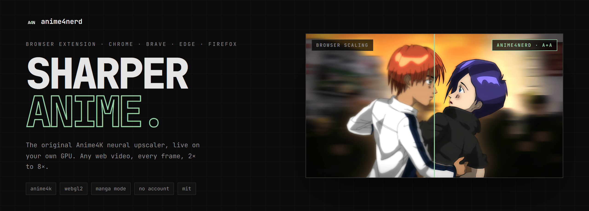</a>

<br>

[](https://chromewebstore.google.com/detail/anime4nerd/kblnmcdmlgeidaclnhjmcffefmkehkpm)
[](https://chromewebstore.google.com/detail/anime4nerd/kblnmcdmlgeidaclnhjmcffefmkehkpm)
[](https://addons.mozilla.org/firefox/addon/anime4nerd/)
[](https://github.com/creedweb3/anime4nerd/releases/latest)
[](LICENSE)

**The original Anime4K neural upscaler, live on your own GPU.**<br>
Switch it on for any web video and every frame is restored and upscaled 2× to 8× while it plays.

[**Add to Chrome**](https://chromewebstore.google.com/detail/anime4nerd/kblnmcdmlgeidaclnhjmcffefmkehkpm) &nbsp;·&nbsp; [**Add to Firefox**](https://addons.mozilla.org/firefox/addon/anime4nerd/) &nbsp;·&nbsp; [**Website**](https://anime4nerd.pages.dev/) &nbsp;·&nbsp; [**Report a problem**](https://anime4nerd.pages.dev/report)

</div>

<br>

## ✦ What you get

<table>
<tr>
<td width="50%" valign="top">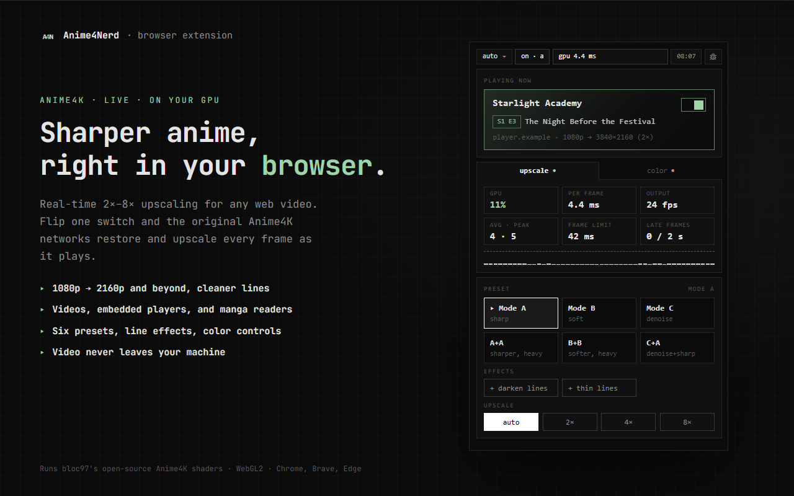<br><b>Any web video, one switch.</b> Six presets, line effects, 2× to 8× output, a live GPU meter, and a per-site switch that remembers the next episode.</td>
<td width="50%" valign="top">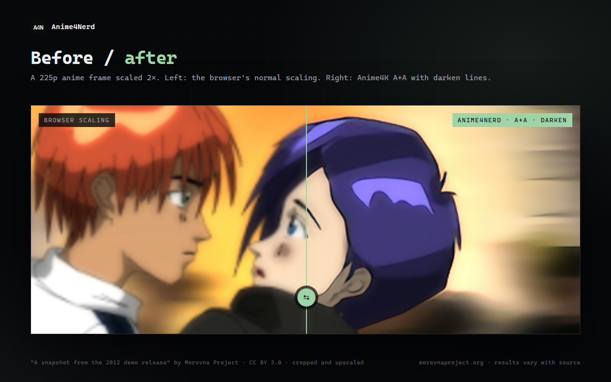<br><b>Cleaner lines, less blur.</b> bloc97's original Anime4K shaders, unchanged, run through WebGL2. No third-party port.</td>
</tr>
<tr>
<td width="50%" valign="top">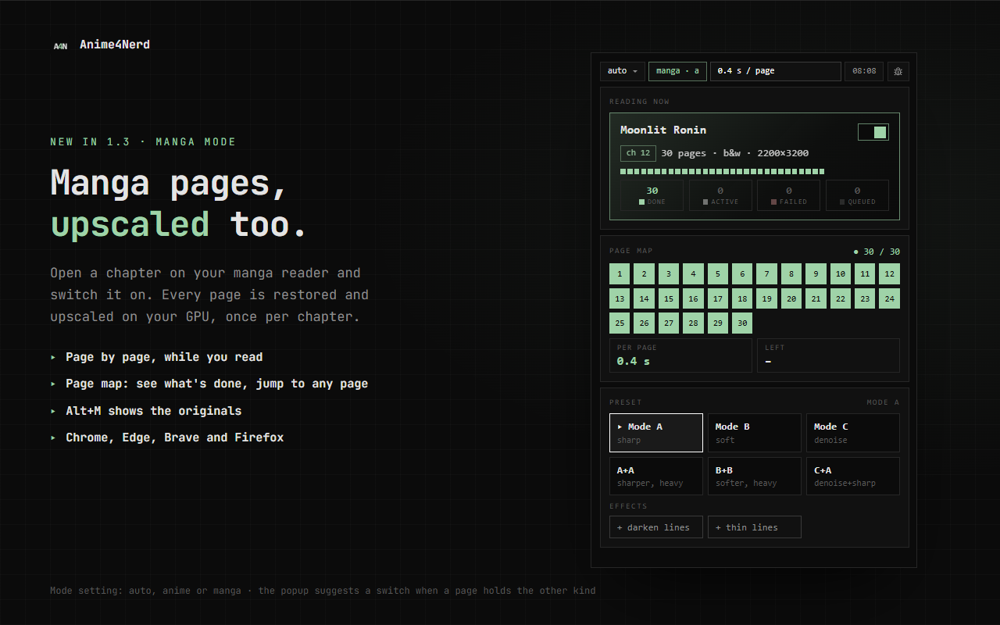<br><b>Manga mode.</b> Manga reader pages upscaled once per chapter, with a page map. <kbd>Alt</kbd>+<kbd>M</kbd> shows the originals.</td>
<td width="50%" valign="top">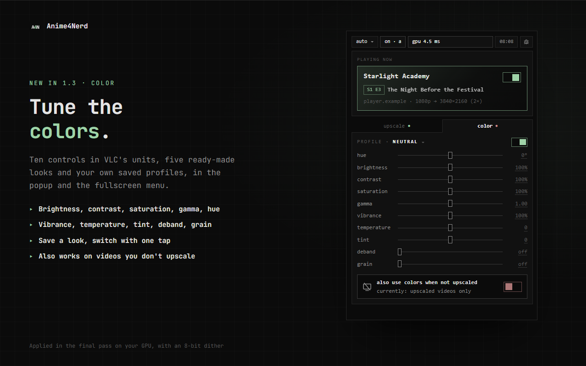<br><b>Color controls.</b> Ten controls in VLC's units, five ready-made looks and your own profiles, also in the fullscreen menu.</td>
</tr>
</table>

<table>
<tr>
<td align="center" width="25%"><b>Private</b><br><sub>No account, no analytics. The video never leaves your machine.</sub></td>
<td align="center" width="25%"><b>Fullscreen menu</b><br><sub>Change anything without leaving fullscreen, even in embedded players.</sub></td>
<td align="center" width="25%"><b>Every browser</b><br><sub>Chrome, Edge, Brave 116+ and Firefox 140+ (desktop).</sub></td>
<td align="center" width="25%"><b>Open source</b><br><sub>MIT, like the Anime4K shaders it runs.</sub></td>
</tr>
</table>

## ✦ How it runs

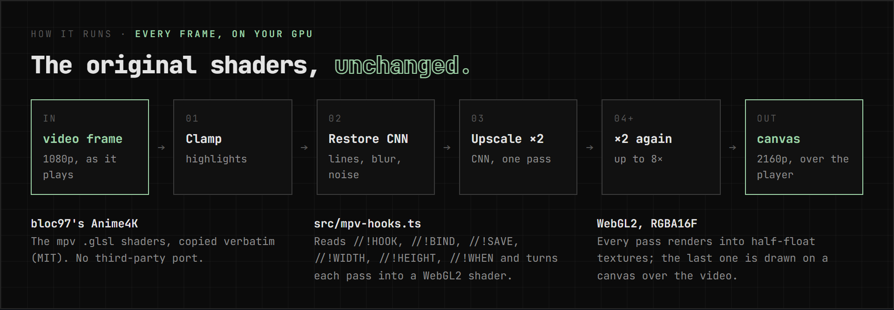

## ✦ Install

<p align="center">
<a href="https://chromewebstore.google.com/detail/anime4nerd/kblnmcdmlgeidaclnhjmcffefmkehkpm">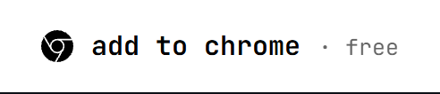</a>&nbsp;&nbsp;
<a href="https://addons.mozilla.org/firefox/addon/anime4nerd/">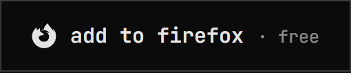</a>
</p>

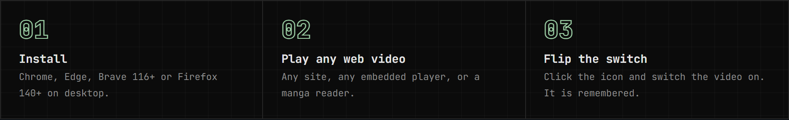

## ✦ Build

```bash
npm install
npm run build            # Chrome, Edge, Brave  ->  dist/
npm run build:firefox    # Firefox              ->  dist-firefox/
npm run pack:firefox     # also writes "Anime4Nerd firefox.zip"
```

## ✦ Under the hood

<p>
<a href="docs/TECHNICAL.md#presets">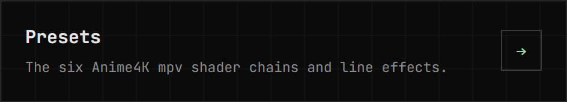</a>
<a href="docs/TECHNICAL.md#upscale-factor">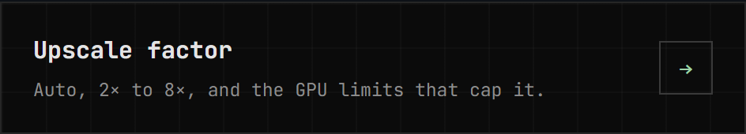</a>
<a href="docs/TECHNICAL.md#how-it-works">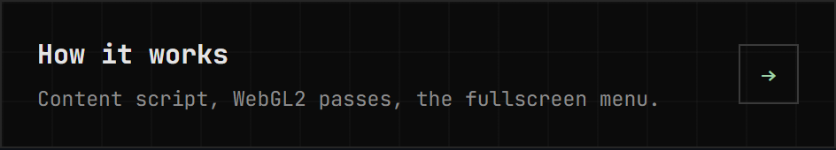</a>
<a href="docs/TECHNICAL.md#video-naming">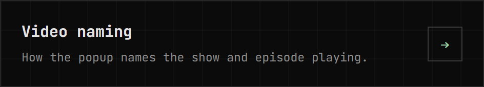</a>
<a href="docs/TECHNICAL.md#gpu-meter">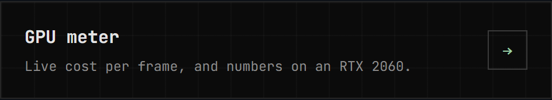</a>
<a href="docs/TECHNICAL.md#limitations">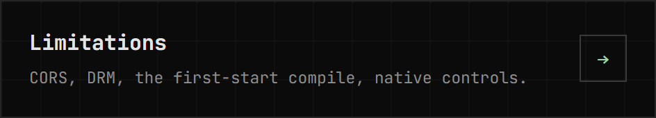</a>
<a href="docs/TECHNICAL.md#testing">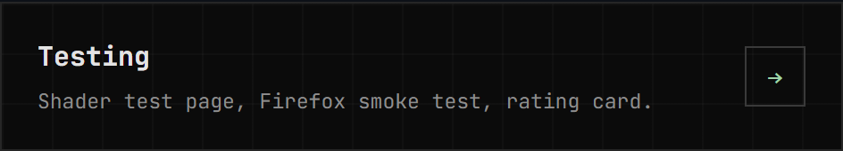</a>
<a href="docs/TECHNICAL.md#load-from-source">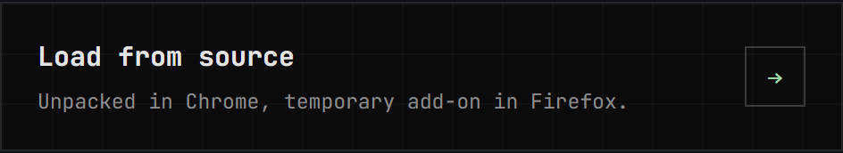</a>
</p>

## ✦ License and privacy

<p>
<a href="LICENSE">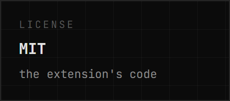</a>
<a href="THIRD_PARTY_NOTICES.md">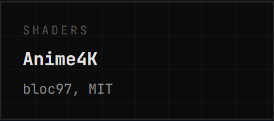</a>
<a href="PRIVACY.md">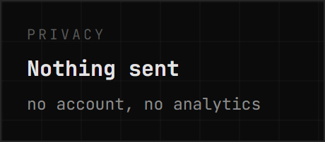</a>
<a href="SECURITY.md">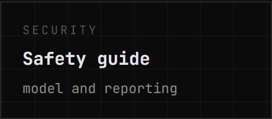</a>
</p>

<div align="center">
<br>
<sub>Banner and before/after frame: "A snapshot from the 2012 demo release from the Morevna Project" by <a href="https://morevnaproject.org">Morevna Project</a>, <a href="https://creativecommons.org/licenses/by/3.0/">CC BY 3.0</a>, cropped and upscaled for comparison.<br>Store listings: <a href="docs/STORE_LISTING.md">Chrome Web Store</a> · <a href="docs/AMO_LISTING.md">Firefox Add-ons</a>. Not affiliated with bloc97 or any streaming site.</sub>
</div>
